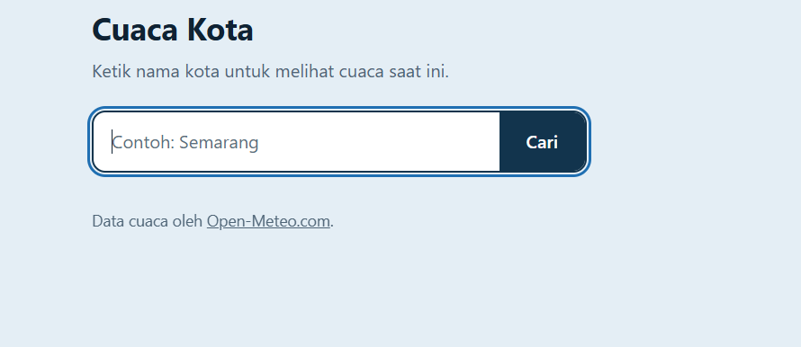

# Weather Data REST Client

Aplikasi web sederhana berbasis PHP yang berperan sebagai **REST Client**: pengguna mengetik nama kota, lalu aplikasi mengambil data cuaca terkini dari [Open-Meteo API](https://open-meteo.com/) menggunakan **PHP cURL** dan menampilkannya dalam tampilan yang rapi.

Project ini dibuat untuk Tugas 7 mata kuliah Pengujian Perangkat Lunak (membuat REST Client untuk public API).

## Tampilan



> Ganti file `screenshots/home.png` dengan tangkapan layar aplikasi kamu.

## Fitur

- Pencarian cuaca berdasarkan nama kota.
- Menampilkan nama kota dan negara.
- Menampilkan suhu, kelembapan, kecepatan angin, dan kondisi cuaca dengan ikon.
- Penanganan error: input kosong, kota tidak ditemukan, koneksi API gagal, dan respons API tidak valid.
- Tampilan minimalis dan responsif (nyaman di ponsel maupun desktop).

## Teknologi

- PHP 8.x dengan ekstensi cURL
- HTML dan CSS (tanpa framework)
- Open-Meteo Geocoding API dan Forecast API (gratis, tanpa API key)

## Instalasi di XAMPP

1. Install [XAMPP](https://www.apachefriends.org/) dengan PHP 8.x.
2. Salin folder `weather-rest-client` ke `C:\xampp\htdocs\`.
3. Buka XAMPP Control Panel, lalu klik **Start** pada **Apache** (MySQL tidak diperlukan).
4. Pastikan ekstensi cURL aktif. Buka `php.ini` (XAMPP Control Panel, Apache, Config) dan pastikan baris `extension=curl` tidak diawali tanda `;`. Jika diubah, restart Apache.

## Menjalankan Aplikasi

Buka browser dan akses:

```
http://localhost/weather-rest-client/
```

Ketik nama kota (misalnya `Semarang`), lalu klik **Cari**.

## Struktur Folder

```
weather-rest-client/
├── index.php        # Halaman utama: form pencarian dan tampilan hasil
├── api.php          # Logika REST Client (PHP cURL) dan pengolahan data
├── style.css        # Tampilan
├── screenshots/     # Tempat tangkapan layar untuk README
├── README.md
└── .gitignore
```

## Cara Kerja REST Client

Satu kali pencarian kota menghasilkan dua HTTP request dari PHP:

1. **Geocoding API**: mengubah nama kota menjadi koordinat (latitude dan longitude).
   `GET https://geocoding-api.open-meteo.com/v1/search?name=Semarang&count=1`
2. **Forecast API**: mengambil cuaca saat ini berdasarkan koordinat tersebut.
   `GET https://api.open-meteo.com/v1/forecast?latitude=...&longitude=...&current=temperature_2m,relative_humidity_2m,wind_speed_10m,weather_code`

Alurnya:

```
Form (index.php) -> getWeatherByCity() -> cURL ke Geocoding API
                                       -> cURL ke Forecast API
                                       -> JSON diubah menjadi array PHP
                                       -> HTML dan CSS menampilkan hasil
```

Semua request dikirim oleh PHP di sisi server menggunakan cURL (`fetchJson()` di `api.php`), bukan oleh JavaScript di browser.

## Skenario Pengujian

| No | Skenario | Cara uji | Hasil yang diharapkan |
|----|----------|----------|-----------------------|
| 1 | Kota valid | Cari `Semarang` | Kartu cuaca tampil: kota, negara, suhu, kelembapan, angin, kondisi |
| 2 | Kota tidak ditemukan | Cari `asdfghjkl` | Pesan: kota tidak ditemukan |
| 3 | Input kosong | Klik **Cari** tanpa mengisi | Pesan: masukkan nama kota terlebih dahulu |
| 4 | Koneksi gagal | Matikan internet, lalu cari kota | Pesan: tidak dapat terhubung ke layanan cuaca |
| 5 | Respons tidak valid | Ubah sementara `GEOCODING_API_URL` di `api.php` menjadi `https://example.com`, lalu cari kota | Pesan: respons layanan kosong atau tidak valid |

Setelah skenario 5, kembalikan `GEOCODING_API_URL` ke nilai semula.

## Pemecahan Masalah

- **`Call to undefined function curl_init()`**: ekstensi cURL belum aktif. Lihat langkah 4 pada bagian Instalasi.
- **Pesan gagal terhubung padahal internet normal**: pada XAMPP versi lama, PHP kadang belum memiliki sertifikat SSL. Unduh `cacert.pem` dari [curl.se/docs/caextract.html](https://curl.se/docs/caextract.html), simpan di mana saja, lalu isi `curl.cainfo` di `php.ini` dengan lokasi file tersebut (contoh: `curl.cainfo = "C:\xampp\php\extras\ssl\cacert.pem"`). Restart Apache setelahnya. Detail error tercatat di log Apache (`C:\xampp\apache\logs\error.log`).

## Sumber Data

Data cuaca disediakan oleh [Open-Meteo.com](https://open-meteo.com/) di bawah lisensi [CC BY 4.0](https://creativecommons.org/licenses/by/4.0/). Penggunaan gratis tanpa API key berlaku untuk keperluan non-komersial.
